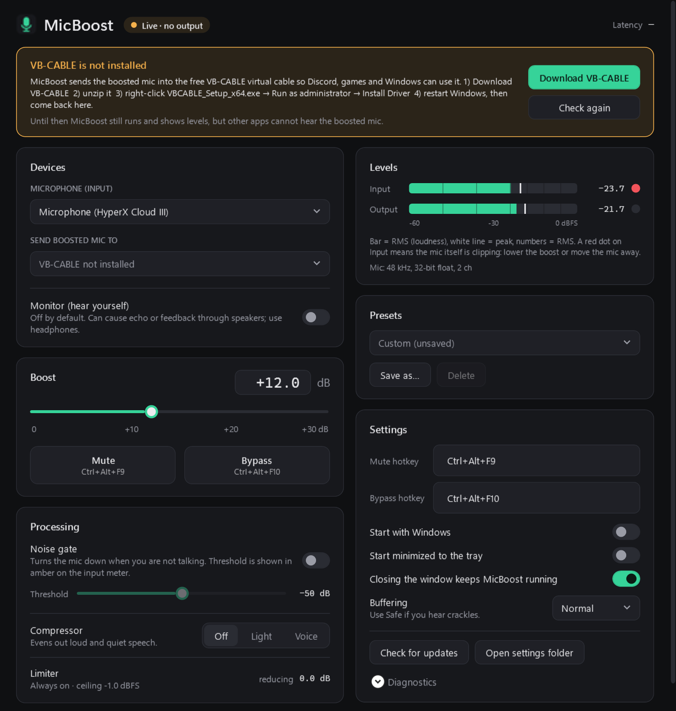

# MicBoost

Make a quiet **HyperX Cloud III** microphone loud enough, without distortion.
MicBoost adds clean software gain (up to +30 dB) plus a noise gate, a compressor and an always-on limiter, and sends the result to a virtual microphone that Discord, games and Windows can use.

[](https://github.com/tuomix/micboost/actions/workflows/build.yml)

## ⬇️ [Download the latest release](https://github.com/tuomix/micboost/releases/latest)

Get **`MicBoost-Setup.exe`** from the release page (or `MicBoost-portable.zip` if you don't want to install anything).

### Install in 4 steps

1. **Install VB-CABLE** (free virtual audio cable, needed once).
   Download it from **<https://vb-audio.com/Cable/>**, unzip it, right-click **`VBCABLE_Setup_x64.exe`** → **Run as administrator** → **Install Driver**, then restart Windows.
   *(VB-CABLE is a separate product by VB-Audio. MicBoost does not include or redistribute it.)*
2. **Run `MicBoost-Setup.exe`.** It installs for your user only, so no administrator rights are needed. It adds a Start menu shortcut and can optionally start MicBoost with Windows.
3. **In MicBoost, choose your HyperX Cloud III as the input.** MicBoost picks it automatically when it is plugged in. Set the **Boost** slider so your voice peaks in the yellow area of the *Output* meter while you talk normally.
4. **In other apps, choose `CABLE Output (VB-Audio Virtual Cable)` as the microphone:**
   - **Discord:** User Settings → Voice & Video → Input Device → *CABLE Output (VB-Audio Virtual Cable)*.
   - **Windows (and apps that use the default mic):** Settings → System → Sound → Input → *CABLE Output*.
   - **Games:** in the game's voice-chat settings pick *CABLE Output*, or leave it on "Default" if you made CABLE Output the Windows default.

> **"Windows protected your PC" (SmartScreen).** MicBoost is not code-signed (a signing certificate costs hundreds of euros a year), and new downloads have no "reputation" yet, so Windows shows this warning for any unsigned app. Click **More info → Run anyway**. If you want to be sure the file is the real one, check its checksum first (below).

### Verify the download (optional)

Each release has a `SHA256SUMS.txt`. In PowerShell, in your Downloads folder:

```powershell
Get-FileHash .\MicBoost-Setup.exe -Algorithm SHA256
```

The long hex string must match the line for `MicBoost-Setup.exe` in `SHA256SUMS.txt` (case does not matter).

### Uninstall

- **Installed version:** Settings → Apps → Installed apps → **MicBoost** → Uninstall. It removes the app, its Start menu shortcut and its "start with Windows" entry, and asks whether to delete your settings (`%AppData%\MicBoost`).
- **Portable version:** in MicBoost, turn off *Start with Windows*, exit from the tray icon, then delete `MicBoost.exe` and the folder `%AppData%\MicBoost`.
- **VB-CABLE** (if you no longer need it): run `VBCABLE_Setup_x64.exe` as administrator again → **Remove Driver**, then restart. Remember to switch Discord and Windows back to your normal microphone.

---



## Features

- **Software gain 0 to +30 dB**, with a slider and a numeric field (type `18.5` and press Enter), smoothed so changes never click.
- **Limiter always on** (look-ahead, ceiling −1 dBFS), so a loud boost never clips or distorts the output. The unit tests prove the output never exceeds the ceiling.
- **Noise gate** with adjustable threshold (shown as an amber marker on the input meter).
- **Compressor presets:** Off, Light, Voice.
- **Live meters** for input and output (RMS bar plus peak line), clipping indicators and limiter gain reduction.
- **Presets:** *Quiet room*, *Noisy room*, *Discord*, plus your own (Save as… / Delete).
- **Global hotkeys** for mute and bypass (default `Ctrl+Alt+F9` / `Ctrl+Alt+F10`, changeable: click the box and press a new combination).
- **Tray icon** with mute, bypass and presets; the icon shows a red dot when muted.
- **Start with Windows** and **start minimized** options.
- **Headset unplugged?** MicBoost shows "Waiting for device" and resumes automatically when it is plugged back in.
- **Optional monitor** (hear yourself): off by default, with a feedback warning.
- **Low latency and low CPU:** about 28 ms added latency measured during development on a real Windows audio device (the app shows its own live estimate) and well under 1 % CPU.
- **Any sample rate:** if the mic and VB-CABLE run at different rates, MicBoost resamples with a proper band-limited filter.
- Settings are saved to `%AppData%\MicBoost\settings.json`. Runs without administrator rights.

### Privacy

No telemetry, no analytics, no automatic updates and **no network connections at all**. *Check for updates* only opens the GitHub releases page in your browser. Audio is processed in memory and is **never recorded, logged or written to disk**.

## How it works

```
HyperX Cloud III mic ─▶ WASAPI capture ─▶ noise gate ─▶ gain ─▶ compressor ─▶ limiter ─▶ resampler ─▶ "CABLE Input"
                                                                                                        │ (VB-CABLE)
Discord / games / Windows ◀── microphone: "CABLE Output" ◀──────────────────────────────────────────────┘
```

**Why not Windows' own "Microphone Boost"?** That option only exists when the audio driver provides it, and the Cloud III's USB driver does not. Probing the device on a real Cloud III showed an endpoint volume range of **−74 dB to 0 dB** (already at 0 dB) and a single driver volume control with the same range: no boost above 0 dB is available in hardware. Software gain is the only way to make it louder.

## Troubleshooting

| Problem | What to do |
|---|---|
| Discord/game hears nothing | Discord's input must be **CABLE Output**. MicBoost's status should say **Live**, and *Send boosted mic to* should be **CABLE Input**. Check that MicBoost is not muted (tray icon without red dot). |
| Yellow banner "VB-CABLE is not installed" | Install VB-CABLE (step 1) and restart Windows, then click **Check again**. If it says *disabled*, enable *CABLE Input* and *CABLE Output* in Sound settings → All sound devices. |
| "Windows is blocking microphone access" | Settings → Privacy & security → Microphone → turn on *Microphone access* and *Let desktop apps access your microphone*. |
| "…is being used in exclusive mode by another app" | Close the other app, or in Sound settings → *Microphone (HyperX Cloud III)* → Properties → Advanced, untick *Allow applications to take exclusive control*. |
| "Waiting for device" | The headset is unplugged or disabled. Plug it in; MicBoost resumes by itself. |
| Crackles or dropouts | Set **Buffering** to **Safe** in Settings. |
| Voice sounds squashed or "pumping" | Lower the boost, or switch the compressor to *Light* or *Off*. |
| Background noise is too loud | Turn on the **noise gate** and raise the threshold until the amber marker sits just above the input level when you are silent. |
| The red dot next to **Input** lights up | The microphone itself is clipping before MicBoost (nothing software can repair). Speak a bit further from the mic or lower your voice. |
| Echo or a howling sound | Turn **Monitor** off. Never select *CABLE Output* as MicBoost's input, and make sure *Listen to this device* is off for CABLE Output in Windows' Recording settings. |
| A hotkey shows "already used by another app" | Pick a different combination in Settings. |
| HyperX NGENUITY devices in the list | NGENUITY adds its own virtual devices. MicBoost uses the physical **Microphone (HyperX Cloud III)**. |
| Settings got corrupted | MicBoost falls back to defaults and keeps a copy as `settings.corrupt.json` in `%AppData%\MicBoost`. |

## Building from source

Requires the .NET 8 SDK (Core and tests also build on Linux/macOS).

```powershell
dotnet test tests/MicBoost.Core.Tests                     # DSP unit tests (any OS)
dotnet publish src/MicBoost.App -c Release -o publish     # single self-contained MicBoost.exe (Windows)
ISCC.exe installer\MicBoost.iss                           # installer (needs Inno Setup 6)
```

`tools/MicBoost.Probe` is a small console tool that lists audio devices, checks for a hardware boost and runs the engine headless (`MicBoost.Probe devices`, `MicBoost.Probe run 10 "CABLE Input" 18`).

Set `MICBOOST_SETTINGS_DIR` to a folder to run MicBoost without touching your real settings.

### Project layout

| Project | Contents |
|---|---|
| `src/MicBoost.Core` | Pure C# (no Windows dependencies): gain, gate, compressor, limiter, meters, resampler, drift control, settings and presets |
| `src/MicBoost.Audio` | WASAPI capture/render (NAudio), device discovery, hot-plug handling, hardware-boost probe |
| `src/MicBoost.App` | WPF user interface, tray icon, hotkeys, start-with-Windows |
| `tests/MicBoost.Core.Tests` | xUnit tests with synthetic signals (sine, silence, noise, clipping) |
| `installer/MicBoost.iss` | Inno Setup script (per-user install to `%LocalAppData%\Programs\MicBoost`) |

### Releasing

Push a version tag; GitHub Actions builds, tests and publishes the release with the installer, the portable zip and `SHA256SUMS.txt`:

```powershell
git tag v1.0.1
git push origin v1.0.1
```

## License

MIT. See [LICENSE](LICENSE). VB-CABLE is © VB-Audio Software and is distributed by them under their own terms.
